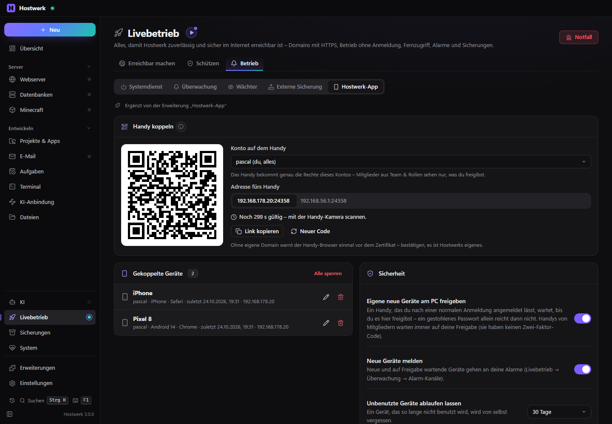
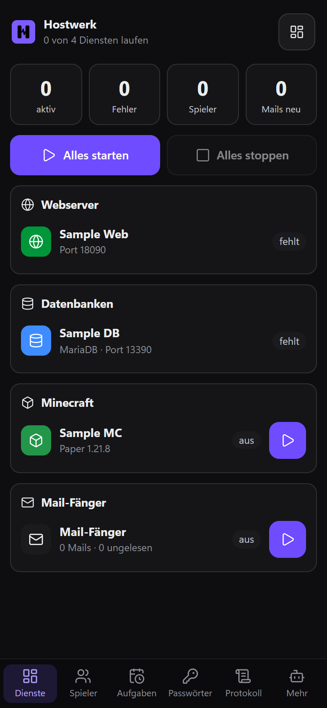

# Hostwerk-App

Hostwerk aufs Handy – als Web-App für Android und iPhone, ohne App-Store. Handy per QR-Code koppeln, gekoppelte Geräte im Blick und einzeln sperren, neue Geräte erst nach Freigabe am PC. Für dich und für Mitglieder aus Team & Rollen, mit deren Rechten.

[English](README.md) · Eine offizielle [Hostwerk](https://github.com/Passimoritz/hostwerk-public) Erweiterung (SDK 3.4, native Erweiterung)



<p align="center"></p>

## Was sie kann

- **Wo:** Livebetrieb → Betrieb → Hostwerk-App und „Handy koppeln …“ in der Fernzugriffs-Karte – kein eigener Eintrag in der Seitenleiste
- **Die Handy-Ansicht** (`#/handy`): große Tipp-Flächen in sechs Reitern – Dienste, Spieler, Aufgaben, Passwörter, Protokoll, Mehr. Schmale Bildschirme starten von selbst dort. Offline zeigt sie den letzten Stand (nur Anzeige).
- **Installierbar wie eine App:** Manifest, Startbildschirm-Symbol und Service Worker – „Jetzt installieren“ auf Android, „Zum Home-Bildschirm“ auf dem iPhone. Kein App-Store, kein Entwicklerkonto, keine Signatur.
- **Koppeln per QR-Code:** ein Einmal-Code für dein Konto oder für ein Mitglied – einmal gültig und nur 5 Minuten. Das Handy bekommt einen eigenen Geräte-Schlüssel und bleibt angemeldet wie eine App.
- **Gekoppelte Geräte:** Name, Konto, Browser, zuletzt gesehen, Adresse – umbenennen, einzeln sperren, alle sperren
- **Freigabe am PC:** Ein Handy, das nach einer normalen Anmeldung angemeldet bleiben soll, wartet auf deine Freigabe. Handys von Mitgliedern warten immer.
- **Sicherheitsprotokoll:** Kopplungs-Codes, Kopplungen, Freigaben, Sperren, abgelaufene Geräte und abgewiesene Codes
- **Mit Fingerabdruck bestätigen:** Alles stoppen, Dienste stoppen und Spieler werfen nur nach dem Passkey des Handys (wahlweise)
- Die alte Adresse `/app-laden` (QR-Codes früherer Versionen) führt zur Anleitungsseite

## Sicherheit

Die Anmeldung selbst bleibt bei Hostwerk: Passwort und Zwei-Faktor-Code, Passkeys, Sperre je Adresse und – neu in Hostwerk 3.0 – je Konto. Diese Erweiterung fügt nur einen weiteren Zugang hinzu, den Geräte-Schlüssel, und Hostwerk fragt ihn bei jeder Anfrage über den Dienst `devices`.

| Angriff | Was passiert |
| --- | --- |
| Kopplungs-Code raten | 128-Bit-Zufallscode, 5 Minuten gültig; jeder falsche Code zählt als Fehlversuch der Adresse – nach 5 ist sie gesperrt |
| Code wiederverwenden (Bildschirmfoto, Schulterblick) | jeder Code gilt genau einmal |
| Geräte-Schlüssel stehlen | gespeichert ist nur ein SHA-256-Fingerabdruck; ein neues Passwort des Kontos macht alle seine Geräte sofort ungültig |
| Schlüssel fälschen | Vergleich in konstanter Zeit; unbekannte, kaputte oder fremde Schlüssel werden nie angemeldet |
| Fremde Webseite schickt Anfragen (CSRF, WebSocket) | der Schlüssel zählt nur bei Anfragen derselben Seite oder vom Nutzer selbst (`Sec-Fetch-Site`) |
| Mitglied lässt ein Handy angemeldet | wartet immer auf die Freigabe des Besitzers – Mitglieder haben keinen eigenen zweiten Faktor |
| Mitglied will mehr | die Rechte kommen bei jeder Anfrage aus Team & Rollen, nie vom Gerät; keine Geräte-Verwaltung, kein Code fürs Besitzer-Konto |
| Mitglied ausgeschaltet, Rechte abgelaufen, entfernt | das Gerät ist sofort draußen |
| Handy verloren | am PC sperren (seine Sitzungen enden sofort) oder „Alle abmelden“ beim Fernzugriff |
| Fernzugriff aus | kein Gerät kommt hinein – der Port ist zu |
| Unbenutztes Gerät | läuft von selbst ab (30 Tage, einstellbar) |
| Öffentliche Seiten | strenge Content Security Policy mit Nonce, kein Einbetten, kein Referrer, nichts zwischengespeichert |

## Installieren

In Hostwerk: **Erweiterungen → Entdecken** und „Installieren“ klicken. Wer den Fernzugriff schon nutzt, bekommt die Erweiterung beim Update automatisch (die Handy-Ansicht war vorher in Hostwerk eingebaut).

Native Erweiterungen laufen als Teil von Hostwerk (eigener Server- und Oberflächen-Teil). Deshalb installiert Hostwerk sie nur aus dem offiziellen Katalog (mit Prüfsumme) oder im Entwickler-Modus.

Braucht Hostwerk mit SDK 3.4 (Vollbild-Ansichten von Erweiterungen, Dienst `devices`) und eingeschalteten Fernzugriff mit Passwort und Zwei-Faktor-Anmeldung.

## Daten

`data/extensions/pwa.json` – gekoppelte Geräte (nur Fingerabdrücke ihrer Schlüssel), Einstellungen und das Sicherheitsprotokoll (die letzten 200 Einträge). Kopplungs-Codes liegen nur im Arbeitsspeicher. Entfernen löscht nichts und meldet alle gekoppelten Geräte sofort ab (ohne Erweiterung gibt es keine Geräte-Schlüssel).

## Entwickeln

```bash
node --test tests/*.test.js                       # Tests – die meisten davon Angriffe
node ../hostwerk/scripts/pwa-security-test.js    # dasselbe gegen ein echtes Hostwerk über HTTPS
node build-native.js .                            # Oberfläche bauen (sdk/build-native.js aus hostwerk-public)
node check.js . --strict                          # dieselbe Prüfung wie der Katalog (sdk/check.js)
node tools/shots.js                               # Bilder für diese README (Wegwerf-Hostwerk)
```

Oberfläche in `ui/src`, Server-Teil in `server/` (`devices.js` = Sicherheit, `pages.js` = öffentliche Seiten). Texte im Code sind Englisch, Deutsch steht in `locales/de.json`.

## Lizenz

MIT
