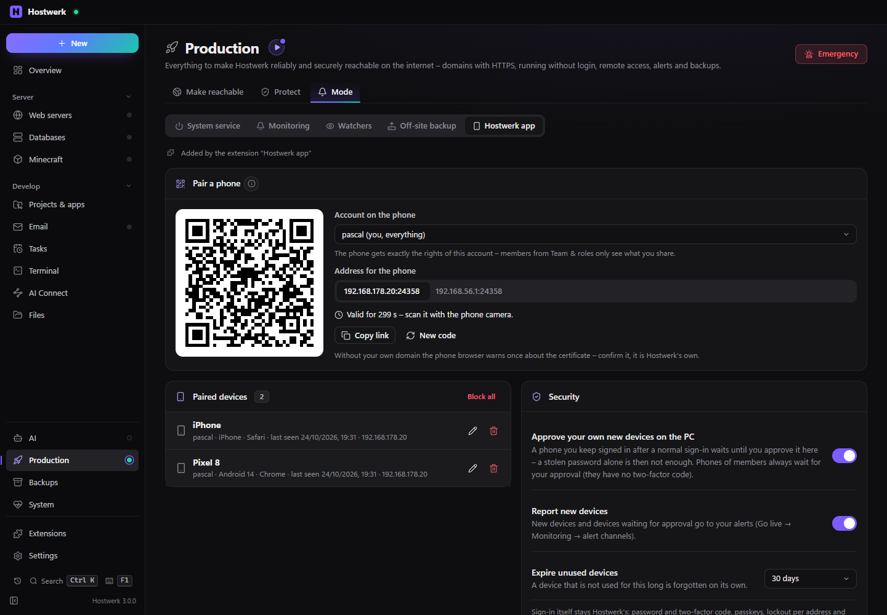
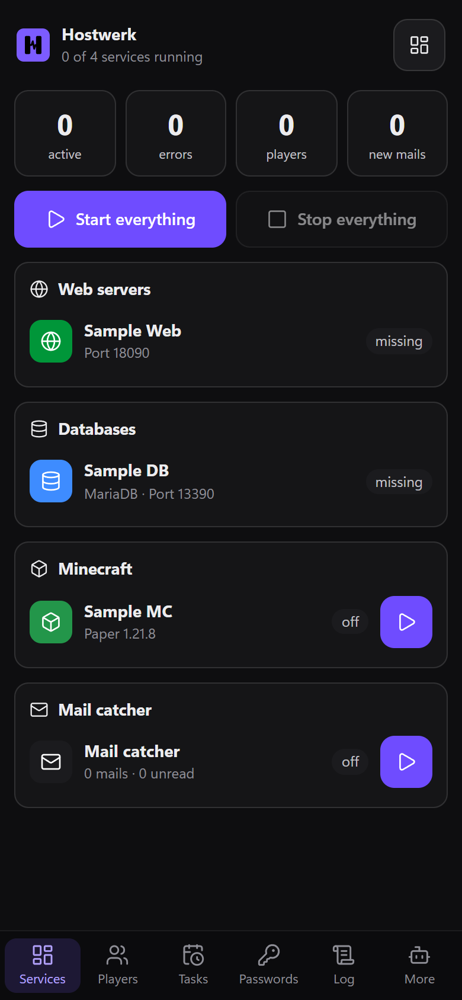

# Hostwerk app

Hostwerk on your phone – as a web app for Android and iPhone, without an app store. Pair a phone with a QR code, keep an eye on paired devices and block them one by one, new devices only after approval on the PC. For you and for members from Team & roles, with their rights.

[Deutsch](README.de.md) · An official [Hostwerk](https://github.com/Passimoritz/hostwerk-public) extension (SDK 3.4, native extension)



<p align="center"></p>

## What it does

- **Where:** Go live → Operations → Hostwerk app, and “Pair phone …” in the remote access card – no own sidebar entry
- **The phone screen** (`#/handy`): big tap targets in six tabs – services, players, tasks, passwords, log, more. Small screens start there by themselves. Offline it shows the last known state (read only).
- **Installable like an app:** manifest, home-screen icon and service worker – “Install now” on Android, “Add to Home Screen” on the iPhone. No app store, no developer account, no signing.
- **Pair with a QR code:** a one-time code for your account or for a member – valid once and only for 5 minutes. The phone gets its own device key and stays signed in like an app.
- **Paired devices:** name, account, browser, last seen, address – rename, block one, block all
- **Approval on the PC:** a phone kept signed in after a normal sign-in waits until you approve it. Phones of members always wait.
- **Security log:** pairing codes, pairings, approvals, blocks, expired devices and refused codes
- **Confirm with fingerprint:** stop everything, stop a service or kick a player only after the phone's passkey (optional)
- The old address `/app-laden` (QR codes from earlier versions) leads to the install page

## Security

Sign-in itself stays in Hostwerk: password and two-factor code, passkeys, lockout per address and – new in Hostwerk 3.0 – per account. This extension only adds one more credential, the device key, and Hostwerk asks it on every request through the service `devices`.

| Attack | What happens |
| --- | --- |
| Guess a pairing code | 128-bit random code, valid 5 minutes; every wrong code counts as a failed sign-in of the address – after 5 the address is locked |
| Reuse a code (screenshot, over the shoulder) | each code works exactly once |
| Steal the device key | stored is only a SHA-256 fingerprint; a new password of the account makes all its devices invalid at once |
| Forge a key | constant-time comparison of the fingerprint; unknown, malformed or foreign keys are never signed in |
| Another website sends requests (CSRF, WebSocket) | the key only counts for same-origin requests or ones the user started (`Sec-Fetch-Site`) |
| A member keeps a phone signed in | always waits for the owner's approval – members have no second factor of their own |
| A member wants more | the rights come from Team & roles on every request, never from the device; no device management, no code for the owner account |
| Member switched off, rights ended, removed | the device stops at once |
| Lost phone | block it on the PC (its sessions end at once) or “Sign out everyone” under remote access |
| Remote access switched off | no device gets in – the port is closed |
| Unused device | expires on its own (30 days, adjustable) |
| Public pages | strict Content Security Policy with nonce, no framing, no referrer, nothing cached |

## Install

In Hostwerk: **Extensions → Discover** and click “Install”. If you already use remote access, the update installs the extension by itself (the phone view used to be built into Hostwerk).

Native extensions run as part of Hostwerk (own server and interface part). That is why Hostwerk only installs them from the official catalogue (with checksum) or in developer mode.

Needs Hostwerk with SDK 3.4 (screens of extensions, service `devices`) and remote access switched on with password and two-factor sign-in.

## Data

`data/extensions/pwa.json` – paired devices (only fingerprints of their keys), settings and the security log (last 200 entries). Pairing codes live in memory only. Removing the extension deletes nothing and signs out every paired device at once (without the extension there are no device keys).

## Develop

```bash
node --test tests/*.test.js                       # tests – most of them attacks
node ../hostwerk/scripts/pwa-security-test.js    # the same against a real Hostwerk over HTTPS
node build-native.js .                            # build the interface (sdk/build-native.js from hostwerk-public)
node check.js . --strict                          # same check as the catalogue (sdk/check.js)
node tools/shots.js                               # pictures for this README (throwaway Hostwerk)
```

Interface source in `ui/src`, server part in `server/` (`devices.js` = security, `pages.js` = public pages). Texts in the code are English, German is in `locales/de.json`.

## License

MIT
